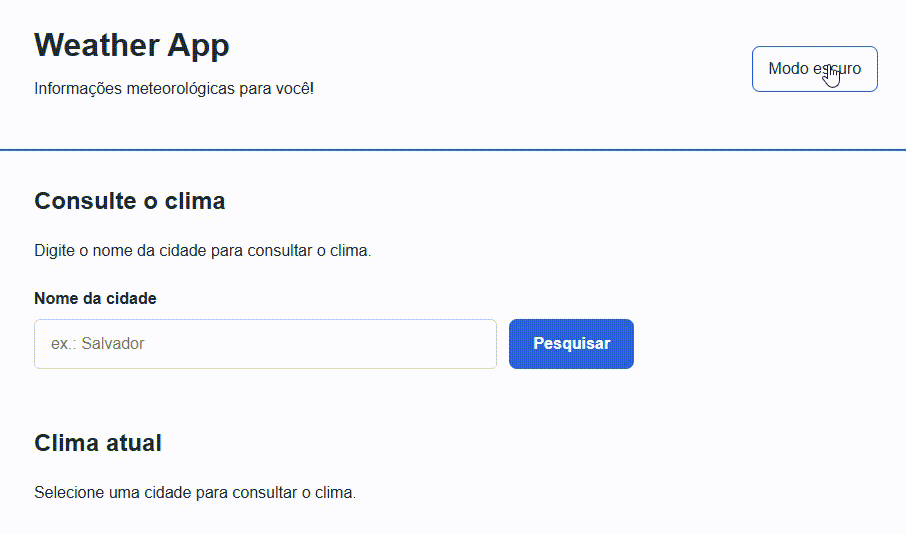

# Weather App ☀️🌧️

Aplicação web para consulta meteorológica e análise climática histórica, com pesquisa de cidades, previsão de cinco dias, gráficos interativos de temperatura e precipitação, histórico de consultas e tema claro/escuro.

Desenvolvida com **HTML, CSS e JavaScript puro**, sem frameworks, utilizando as APIs da Open-Meteo e a biblioteca Chart.js para visualização de dados.

## Demo ao vivo

[Acesse o Weather App](https://github.com/rikrdopires/Projeto-4---weather-app.git)

## Funcionalidades

- Pesquisa de cidades com sugestões de localidades
- Consulta de temperatura, umidade, vento e condições meteorológicas atuais
- Previsão do tempo para os próximos cinco dias
- Histórico das cinco cidades consultadas recentemente
- Persistência do histórico e do tema com `localStorage`
- Alternância entre tema claro e escuro
- Seleção de intervalo de anos para análise climática histórica
- Visualização de quatro gráficos interativos:
  - Temperatura média anual (°C)
  - Precipitação acumulada anual (mm)
  - Temperatura média mensal do período (°C)
  - Precipitação média mensal do período (mm)
- Atualização dos gráficos conforme a cidade e o período selecionados
- Tratamento de erros de conexão e respostas das APIs
- Indicadores de carregamento e controle de requisições concorrentes
- Layout responsivo para computadores, tablets e celulares
- Acessibilidade básica com HTML semântico, `aria-label`, `aria-live` e foco visível

## Tecnologias

- **HTML5** — estrutura semântica e formulários
- **CSS3** — variáveis, Flexbox, Grid, responsividade e temas
- **JavaScript ES6+** — DOM, eventos, arrays, objetos, `fetch`, `async/await` e `localStorage`
- **Chart.js** — gráficos interativos de séries climáticas
- **Open-Meteo API** — dados meteorológicos atuais, previsões e séries históricas
- **GitHub Pages** — hospedagem estática da aplicação

## O que aprendi

- Organizar uma aplicação em **constantes, seletores DOM, estados, funções, eventos e inicialização**
- Separar consulta de dados, processamento e renderização
- Integrar APIs externas utilizando `fetch` e `async/await`
- Trabalhar com objetos JSON e respostas HTTP
- Manipular dinamicamente o DOM com `createElement`, `appendChild` e `replaceChildren`
- Persistir informações no navegador utilizando `localStorage`
- Trabalhar com datas e intervalos temporais em JavaScript
- Processar séries de dados utilizando `forEach`, `map`, `filter` e `reduce`
- Calcular médias de temperatura e acumulados de precipitação
- Organizar informações climáticas em séries anuais e mensais
- Construir gráficos interativos com Chart.js
- Implementar validações, tratamento de erros e estados de carregamento
- Evitar condições de corrida (*race conditions*) com identificadores de requisição
- Adaptar componentes gráficos aos temas claro e escuro
- Aplicar responsividade com CSS Grid, Flexbox e media queries
- Utilizar DevTools para depuração com Console, Network, Elements e Application

## Preview

 

## Como rodar

Clone ou baixe este repositório.
2. Abra a pasta do projeto no VS Code.
3. Execute o arquivo `index.html` utilizando a extensão Live Server.
4. Pesquise uma cidade para consultar as informações meteorológicas.
5. Selecione um intervalo de anos para visualizar a análise climática.

**Não é necessário instalar dependências ou executar processos de build.**

É necessária conexão com a internet para acessar as APIs da Open-Meteo e carregar o Chart.js.

## 📂 Estrutura

    weather-app/
    │
    ├── index.html 
    ├── style.css 
    ├── script.js   
    ├── README.md 
    └── preview.png 

## Fonte dos dados

Os dados são obtidos por meio das APIs da [Open-Meteo](https://open-meteo.com/).

- **Geocoding API:** identificação de cidades e coordenadas geográficas
- **Forecast API:** condições meteorológicas atuais e previsão de cinco dias
- **Historical Weather API:** séries históricas de temperatura e precipitação

A análise histórica utiliza dados de reanálise meteorológica ERA5, que representam estimativas modeladas das condições atmosféricas, não medições diretas de estações meteorológicas.

## Autor
Desenvolvido por **Ricardo Ribeiro** como parte do meu portfólio de estudos em ADS.